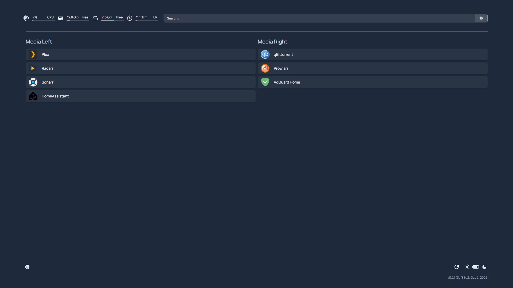
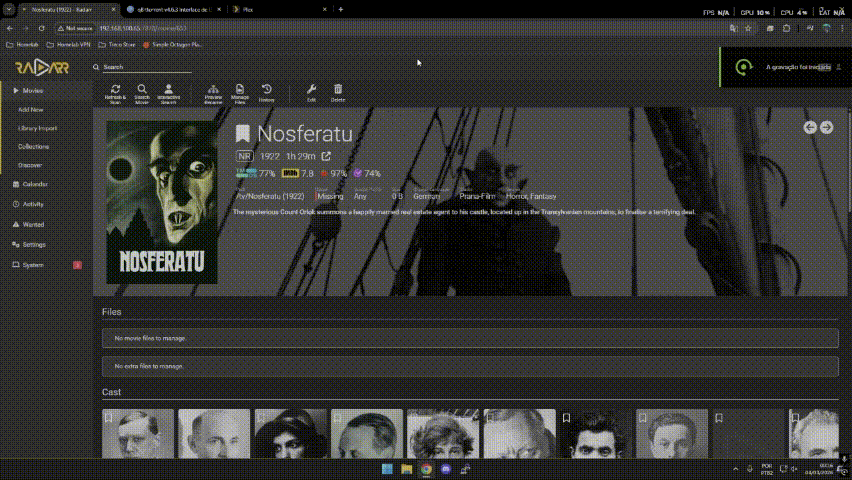
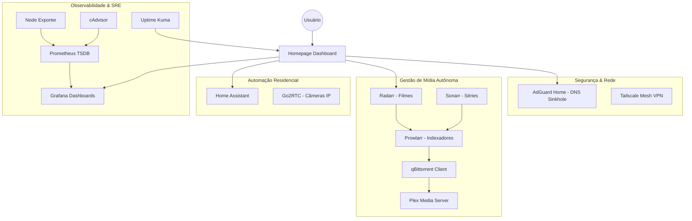

# My Homelab Architecture & Infrastructure

  
  
  
  
  
  
  
  

Repositório dedicado à arquitetura, automação e operação da minha infraestrutura pessoal *self-hosted* em Ubuntu Server. Este projeto funciona como ambiente de produção doméstica de alta disponibilidade e laboratório prático para Docker, automação residencial, observabilidade (SRE) e segurança de redes.

---

## Sumário

- [Hardware Host & Especificações](#hardware-host--especificações)
- [O Projeto: Motivação e Implementação](#o-projeto-motivação-e-implementação)
  - [Ecossistema de Mídia e Automação de Conteúdo](#ecossistema-de-mídia-e-automação-de-conteúdo)
  - [Infraestrutura de Rede, Privacidade e Segurança](#infraestrutura-de-rede-privacidade-e-segurança)
  - [Central de Automação Residencial (Home Assistant)](#central-de-automação-residencial-home-assistant)
  - [Observabilidade & Telemetria (SRE)](#observabilidade--telemetria-sre)
  - [Eficiência Energética & Alta Disponibilidade](#eficiência-energética--alta-disponibilidade)
  - [Políticas de Backup & Resiliência](#políticas-de-backup--resiliência)
- [Visual Stack & Dashboards](#visual-stack--dashboards)
- [Docker Stack & Serviços](#docker-stack--serviços)
- [Topologia Geral da Infraestrutura](#topologia-geral-da-infraestrutura)
- [ChatOps Discord Bot](#chatops-discord-bot)

---

## Hardware Host & Especificações

* **Host:** Dell Latitude 3420 (Notebook reaproveitado como servidor silencioso e de alta eficiência)
* **CPU:** 11th Gen Intel® Core™ i7-1165G7 (8 threads @ até 4.70 GHz)
* **Memória RAM:** 16GB DDR4
* **Armazenamento:** 500GB SSD NVMe (sistema operacional e volumes de containers) + 500GB HD (armazenamento de mídia e dados)
* **Sistema Operacional:** Ubuntu Server 24.04.3 LTS (Noble Numbat)
* **Kernel:** Linux 6.8.0-101-generic
* **Alimentação & UPS:** Bateria integrada operando como nobreak (UPS) nativo contra interrupções da rede elétrica

---

## O Projeto: Motivação e Implementação

Este projeto nasceu com o objetivo de aprimorar habilidades práticas em engenharia de sistemas e infraestrutura, otimizando a rotina do dia a dia através da cultura *Self-Hosted*.

### Ecossistema de Mídia e Automação de Conteúdo
O foco inicial foi a centralização e organização de mídia na rede doméstica. Utilizando o **Plex Media Server**, foi estabelecida uma interface fluida e compatível com diversos clientes, incluindo sistemas fechados como Roku TV. Para tornar o pipeline totalmente autônomo, estruturei uma stack integrada composta por **qBittorrent, Prowlarr, Radarr e Sonarr**.

Nesta arquitetura, o **Prowlarr** gerencia os indexadores e feeds que abastecem o Radarr e o Sonarr. Ao solicitar um título, o sistema localiza automaticamente a melhor release, envia o comando de download ao qBittorrent e, após a conclusão, o arquivo é importado, renomeado e disponibilizado no Plex para todos os dispositivos autorizados com apenas um clique.

### Infraestrutura de Rede, Privacidade e Segurança
Com a camada de mídia estabilizada, a prioridade foi o isolamento, performance e privacidade da rede local:
* **DNS Sinkhole:** Implementação do **AdGuard Home** como DNS primário da rede. Com suporte da comunidade, foram integradas listas de bloqueio de anúncios, telemetrias e domínios maliciosos. Apontado diretamente no gateway, garante navegação limpa e segura em smartphones, TVs, consoles e computadores.
* **Malha Privada (Mesh VPN):** Integração com **Tailscale** para interconexão segura ponto a ponto entre dispositivos remotos e o homelab, sem necessidade de abertura de portas (port forwarding) no roteador.
* **Borda Protegida:** Acesso a endpoints web seletivos através de túneis seguros da Cloudflare com terminação TLS.

### Central de Automação Residencial (Home Assistant)
O gerenciamento dos dispositivos conectados é centralizado no **Home Assistant**, integrando sensores e atuadores em uma visão unificada:
* **Dispositivos Tuya:** Integração de lâmpadas, interruptores e tomadas inteligentes.
* **Rotinas & Comandos de Voz:** Conexão com Amazon Echo Dot para rotinas automáticas de iluminação e conforto.
* **Streaming de Câmeras IP:** Retransmissão de baixa latência através do **Go2RTC**.
* **Inteligência Artificial (OpenRouter via HACS):** Consultas e assistência automatizada integradas ao painel.
* **Spotify Developer API:** Controle centralizado de reprodução musical em múltiplos ambientes.

### Observabilidade & Telemetria (SRE)
Para elevar o projeto ao padrão de confiabilidade de produção, foi integrada uma stack dedicada de observabilidade contínua:
* **Métricas Temporais:** **Prometheus** configurado com scrape a cada 15 segundos e retenção histórica de 15 dias.
* **Telemetria de Host:** **Node Exporter** coletando carga de CPU, saturação de RAM, tráfego de rede e estatísticas de disco.
* **Telemetria de Containers:** **cAdvisor** monitorando o consumo de recursos individual de cada container Docker.
* **Visualização:** Dashboards dinâmicos no **Grafana** para acompanhamento em tempo real e análise de capacidade.
* **Monitoramento de Uptime:** **Uptime Kuma** realizando checagens ativas de integridade em serviços internos e externos (como `telalivre.live`).

### Eficiência Energética & Alta Disponibilidade
Visando baixo custo operacional e sustentabilidade, o servidor foi calibrado para consumo mínimo:
* **Consumo em Repouso (Idle):** Média estável de **~9.3 W** de potência instantânea.
* **Consumo em Carga Ativa:** Faixa de **12 W a 16 W** durante transcodificações ativas no Plex.
* **Proteção contra Quedas de Energia:** A bateria nativa do notebook atua como UPS contínuo, absorvendo micro-quedas e oscilações de energia sem downtime.

### Políticas de Backup & Resiliência
Por se tratar de um ambiente central para rotinas diárias e serviços produtivos, as rotinas seguem uma política preventiva rigorosa:
* **Snapshots Programados:** Backups automáticos das configurações do Home Assistant e das bases de dados.
* **Redundância Híbrida:** Cópias locais de segurança combinadas com sincronização remota via **SFTP** e replicação criptografada no **Google Drive** via API.
* **Checkpoints Preventivos:** Realização de backups manuais pontuais antes de atualizações essenciais do sistema operacional.

---

## Visual Stack & Dashboards

Abaixo, os painéis de controle utilizados para gerenciar e monitorar o ecossistema do Homelab:

### 1. Dashboard Principal (Homepage)
Ponto de entrada único para todos os serviços hospedados no servidor, organizado por categorias (*Media, Services, System*).

### 2. Gestão de Rede & DNS (AdGuard Home)
Monitoramento de tráfego, filtros de privacidade e bloqueio de anúncios em nível de rede.

### 3. Central de Automação (Home Assistant - Desktop)
Interface administrativa para controle de iluminação, dispositivos inteligentes e monitoramento do sistema.

### 4. Interface Mobile (Home Assistant)
Otimização para controle via smartphone, com foco em ergonomia e acesso rápido.

### 5. Fluxo Automatizado de Mídia para o Plex
Demonstração do fluxo de busca no Radarr/Sonarr, download interativo no qBittorrent e disponibilização imediata no Plex:

---

## Docker Stack & Serviços

A infraestrutura é dividida em stacks modulares declarativas:

| Stack | Serviços Principais | Finalidade |
| :--- | :--- | :--- |
| **Network & Security** | AdGuard Home, Tailscale | DNS Sinkhole, resolução de nomes e rede Mesh segura |
| **Media Pipeline** | Radarr, Sonarr, Prowlarr, qBittorrent, Plex Media Server | Automação e biblioteca de mídia com streaming local |
| **Automation & IoT** | Home Assistant, Go2RTC | Central de automação residencial e gestão de câmeras |
| **Observability (SRE)**| Prometheus, Grafana, Node Exporter, cAdvisor, Uptime Kuma | Coleta de métricas do SO, containers e dashboards |
| **Portal / Dashboard** | Homepage | Portal unificado de navegação e status |

---

## Topologia Geral da Infraestrutura

---

## ChatOps Discord Bot

Além da automação tradicional, foi desenvolvido um bot privado em Python para Discord, focado no gerenciamento remoto e monitoramento em tempo real de toda a infraestrutura do Homelab. Ele permite acompanhar a integridade do servidor e executar tarefas operacionais diretamente pelo chat de forma segura.

> O código-fonte e a documentação técnica dedicada deste bot estão versionados no repositório privado [souusa26/homelab-bot](https://github.com/souusa26/homelab-bot).

### Recursos Principais
* **Telemetria do Host:** Acompanhamento contínuo de uso de CPU, memória RAM, armazenamento em disco e temperatura.
* **Gestão de Containers & Serviços:** Controle direto de containers Docker e serviços gerenciados via `systemd`.
* **Métricas de Energia:** Monitoramento de consumo elétrico integrado via `powerstat`.
* **Alertas & Health Checks:** Notificações proativas sobre o status de estabilidade do ecossistema.

### Serviços Integrados
* **Infraestrutura & SO:** Docker, Systemd, Ubuntu Server 24.04 LTS
* **Mídia & Automação:** Plex Media Server, qBittorrent, Radarr, Sonarr, Prowlarr, Lidarr, FlareSolverr
* **Rede & Casa Inteligente:** Home Assistant, AdGuard Home

### Comandos Disponíveis

| Categoria | Comando | Descrição / Finalidade |
| :--- | :--- | :--- |
| **Informativos** | `!server` | Exibe o status geral e uso de recursos do servidor |
| | `!docker` | Lista a situação atual dos containers Docker |
| | `!compose` | Verifica o status dos serviços via Docker Compose |
| | `!ip` | Retorna os endereços de IP atuais do host |
| | `!temp` | Monitora a temperatura dos componentes de hardware |
| | `!health` | Executa um check-up geral de integridade do sistema |
| | `!power` | Exibe o consumo energético aferido em tempo real |
| | `!status <serviço>` | Consulta o estado específico de um serviço ou container |
| **Controle** | `!start <serviço>` | Inicia o serviço ou container especificado |
| | `!stop <serviço>` | Interrompe o serviço ou container especificado |
| | `!restart <serviço>` | Reinicia o serviço ou container especificado |
| | `!reboot` | Realiza o reboot controlado do servidor físico |

### Segurança e Isolamento
* **Autenticação por ID:** Validação estrita baseada em *Discord User ID* (apenas usuários homologados interagem com os comandos).
* **Segregação de Canais:** Canais separados para comandos administrativos e recebimento de alertas automáticos.
* **Privilégios Mínimos:** Permissões de `sudo` restritas estritamente aos comandos operacionais necessários.
* **Ambiente Virtual Isolado:** Execução em `venv` dedicado, sem contaminação do escopo global do sistema.

### Stack Técnica
* **Linguagem:** Python
* **Framework:** `discord.py`
* **Bibliotecas Operacionais:** `psutil`, `powerstat`, Docker SDK, `systemd`
